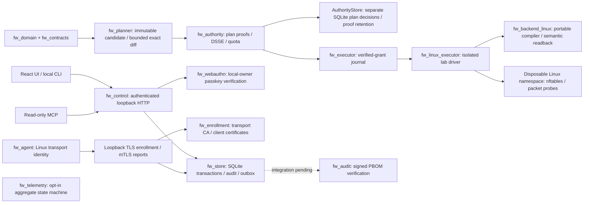

# Implementation design and current boundaries

The original specification under `docs/specs` is retained byte-for-byte. Attached prompts and installation skills were interpreted as project material; they did not authorize publication, paid resources, credential acquisition, or live firewall changes. The current user decisions extend the UI to German and French, make English the default regardless of browser language, and keep detailed development evidence outside source commits. Other F-2.0 acceptance requirements remain unchanged.

## Trust and process boundaries

The controller holds a separate enrollment CA key for transport certificates. It does not hold a policy-signing key, import a privileged backend, or dispatch a native firewall write. The isolated execution driver connects authority verification and the executor journal to real nftables inside a disposable lab. Its synthetic fixture authority is separate from the controller and does not implement human approval or production authority bootstrap. Audit and telemetry libraries remain separate integrations. Distinct crate boundaries do not establish independent OS-process security; deployment of separate accounts, authenticated IPC, signer service and native watchdog remains required. New access requests are atomically stored as `needs_info` with a failed validation operation because workload binding and policy authority remain unavailable. There is no timer that promotes a request into an active lease.

## Runtime profile

The executable is an explicit development profile. Operator HTTP and the optional device TLS listener both bind to loopback. The browser origin defaults to `http://localhost:8787`; WebAuthn verifies the exact configured origin and `localhost` RP ID. The one-use console token permits initial local-owner enrollment and is removed on successful consumption. A durable enrollment marker then blocks bootstrap and previous bootstrap sessions, including after restart or an IP-origin configuration change. It does not enroll a signing authority or approve a plan.

`fw_webauthn` uses pinned `webauthn-rs` for required user presence/verification, signed authentication, credential counters and backup-state handling. Registration uses no hardware attestation and creates a pending credential; only a subsequent verified signature activates it and issues a passkey session. Addition/revocation requires a passkey authentication less than five minutes old, and an unverified spare cannot justify revoking the last verified credential. Challenge verification, current credential checks, successful consumption, credential updates and proof/audit storage share a bounded SQLite transaction. Failed proofs do not successfully consume a challenge. The controller's credential database is local login authority, not an independent signer's trusted credential registry.

Cookies are HttpOnly/SameSite=Strict and scoped to `/`. Every session, including initial bootstrap, requires the memory-held CSRF proof on authenticated reads as well as writes, so a cookie received by a different localhost-port service cannot alone recover the proof or take over owner registration. The initial authentication response supplies this proof; no session secret is persisted in browser storage. Browser reload/new-tab login starts a new passkey authentication after enrollment. Losing a bootstrap tab before any owner registration requires restarting the local controller for a fresh console token; a registered or pending owner never reopens bootstrap. Authenticated writes additionally require exact Origin and a UUID idempotency key. Unauthenticated login ceremonies require exact Origin, bounded requests and a server-issued browser binding. Login options carry compressed, process-key-encrypted state in a bounded opaque ticket without allocating a pending database row or spending a global history quota. Protected registration retains its separate database budget. Only verified login completion stores durable consumption, original state/proof and audit; invalid proofs use bounded denial summaries. Pending tickets expire after five minutes and become invalid on restart. Authentication completions are deliberately single-use: repeating a successful assertion cannot mint another session, and a lost response requires a fresh login. Sessions are memory-only and end on restart; credentials and owner enrollment remain durable. Each request checks that its bound credential is still verified and unrevoked. Development HTTP does not set Secure; remote operator TLS/OIDC remains unsupported. Tenancy is server-selected; body IDs cannot change the session tenant. Store APIs independently enforce tenant/project isolation. See the [passkey protocol and lifecycle](passkey-login.md).

API syntax is bounded at 64 KiB and depth 32, rejects duplicate/unknown fields, floats and unsafe integers. Requests normalize local NFC fields and sort set-valued IDs before hashing. Reply JSON is capped at 256 KiB. Public error details contain stable codes, never SQL or credential values. Credential-free anonymous protected GET probes do not append persistent denial events. Explicit credential/write failures retain an initial sample and follow-up counts in at most 16 fixed per-process reason buckets, coalesced at most once per minute. Migration 5 commits each immutable count summary and its audit evidence reference together. Unflushed RAM counts can be lost on crash, so this is not a complete per-request access log. Bootstrap wrong-token attempts are temporarily limited after ten failures per 60 seconds; a correct unused/unexpired token remains usable. Successful consumption invalidates the token hash and removes the pinned private token file before returning a session; unsafe cleanup fails without issuing a session. Remote authentication is not implemented.

Exact canonicalization is the supplied closed ASCII-property/integer profile, not arbitrary JSON JCS. Signed payload bytes and external identities are not Unicode-normalized. Complete serializers and semantic checks for every extended schema are not yet implemented; reference contract validators remain design-only evidence.

The interface defaults to English and supports explicit selection of Korean, Japanese, Spanish, German, French, Simplified Chinese and Traditional Chinese. A saved supported selection is restored; browser language alone does not change the default. Translation key and interpolation parity are checked, while native-language review and full accessibility acceptance remain incomplete.

## Implemented HTTP surface

- `/healthz`: process readiness.
- `/api/v1/session/bootstrap`, `/session`, `/status`: explicitly documented development extensions.
- `/auth/status`, `/auth/passkeys`, registration/login option and completion routes, credential revocations and `/auth/logout`: actual local-owner WebAuthn lifecycle. Completed authentication proofs cannot be replayed to retrieve session cookies.
- `/auth/cli/requests` and request view/authorization/exchange routes: bounded browser-authorized CLI login. The browser confirms the terminal code with a recent passkey session; a separate one-use polling secret obtains the CLI session while retaining the original authentication time. Pending authorization is bound to that browser session and cannot survive its logout or replacement.
- `/api/v1/access-requests` GET/POST and `/{id}`: strict core access request; atomic persistence and immutable idempotent response.
- `/api/v1/operations` and `/{id}`: actual SQLite operation evidence.
- `/audit/events`: bounded audit snapshot pages with authenticated session/tenant/route/filter cursors. `/audit/denial-summaries/{hash}` resolves content-verified, tenant-scoped evidence linked from denial audit events.
- `/assets`, `/services`, object GET and `/revisions` POST: actual immutable tenant-scoped catalogues with canonical hashes, exact ETags/If-Match, idempotency, retirement and audit/outbox transactions. Only manual provenance is accepted. Service creation requires existing same-tenant assets and a registered target with a current certificate and capability report.
- `/enrollment-tokens` POST, `/enrollments` GET and `/enrollments/{target_id}/revoke` POST: protected invitations, actual registration metadata and credential revocation.
- `/targets` and `/{id}`: actual registered targets after their first authenticated capability report. Missing observations remain null; stale reports and expired/revoked credentials quarantine the target.
- `/policies`: empty applied catalogue. Stored draft policies are not presented as enforced policies.
- `/deployments`, `/approvals/challenges`, `/approvals/assertions`: explicit unsupported-profile refusal. No permissive approval fallback.
- `/mcp`: authenticated JSON-RPC initialize/ping/tool listing and three bounded read tools. Not full production MCP transport/session interoperability or the entire prescribed six-tool suite.

Shared implemented request/list/operation/audit responses are validated against the unchanged F OpenAPI in the HTTP smoke. Development capability/session/status shapes are not represented as full production F contracts. Audit REST and MCP reads return bounded snapshot pages and a `next_cursor` rather than failing because more events exist. HMAC-SHA256 cursors bind tenant, principal/session, route, filter, limit, snapshot and continuation sequence for an unchanged 15-minute lifetime. The process-only key and current authentication checks prevent reuse across restart or session replacement. Other list endpoints retain their bounded-dataset `RESULT_TOO_LARGE` behavior; complete catalogue/request snapshot pagination remains unimplemented. See the [audit read and denial-evidence guide](audit-log.md). Static SPA deep links are individually mapped; API errors remain JSON.

## Device transport registration

The optional listener on `127.0.0.1:8791` uses TLS 1.3 and a separately initialized transport CA. `/internal/v1/enroll` accepts a valid invitation and Ed25519 CSR without a client certificate. `/internal/v1/capabilities` and `/internal/v1/device-status` require mutual TLS plus a current, non-revoked certificate in the same tenant's registration database. Invalid presented client certificates are rejected. This listener does not expose operator sessions or privileged policy dispatch.

An authenticated operator binds a ten-minute invitation to the device's public key fingerprint. The CLI saves the private invitation before submission and sends only the token hash to the operator API. SQLite persists that hash, a single issuance reservation, its fixed timestamp, request identity and CSR hash. Exact retries regenerate the same certificate without extending its validity. Certificate completion, token consumption, target registration, audit and outbox writes are atomic. The CSR cannot choose tenant, target, SAN or authority roles.

The CA, TLS server and device have separate keys. The root lasts 365 days, the server certificate 30 days, and a device certificate at most 24 hours. The response advertises renewal after eight hours, but renewal and rotation are not implemented. Initialization never replaces existing PKI. Clients require a CA file and its exact bundle hash through a trusted channel, check the TLS hostname, use only configured roots, and reject redirects. The [enrollment guide](device-enrollment.md) describes the protected files and workflow.

The Linux agent measures its kernel version, executable hash and available nftables version. Every enforcement feature remains `unverified`; profiles, protocols and qualification claims are empty. Its report lasts five minutes. A report is authenticated device metadata, not independent machine attestation or proof of installed rules. Only then does `/targets` return a complete `TargetView` with a real capability hash, null desired/observed state hashes, and authority epoch/generation `0`. A current target can be selected in the service catalogue, while access requests still remain `needs_info` until workload and authority integration exists. Revocation blocks subsequent device authentication and new service references; it does not change a host firewall.

## Pure policy and authority semantics

Domain evaluation uses explicit time, tenant, target and original business-flow tuple. Deny persists past its review date; allow expires at the exclusive bound. Canonical CIDRs, family/protocol, interface aliases and port ranges are validated. Scope subset evaluation handles adjacent covering CIDRs/ranges. Protected management baseline and actual native reply/conntrack association are separate gates.

Planner preserves the complete baseline, revision/hash preconditions and tombstones, forbids general-route allow expansion, and computes a bounded exact partition over IPv4/IPv6 TCP/UDP CIDR/port/interface/time boundaries. Unsupported ICMP, changed management context or resource exhaustion produces UNKNOWN. A sound business-domain diff does not certify OS enforcement.

Authority validates Ed25519 DSSE domain separation, tenant/target/epoch/generation/content/expiry and immutable human approval requirements. Fixed Lab/Team/high-risk role profiles are enforced. Typed plan and authority-bootstrap challenge payloads bind tenant, principal, immutable subject, requirements, decision, role, RP/origin and bounded time with a fresh random nonce. Separate domain-prefixed hashes feed actual WebAuthn verification through an opaque proof bridge. This low-level result alone does not commit an approval. See the [approval proof boundary](policy-approval-proofs.md).

The separate `AuthorityStore` adds SQLite plan-decision admission using its own explicitly provisioned principal, pinned credential and scoped-role records. Credentials require a persisted signed activation before use. Full immutable plan and requirements bytes are admitted with closed contract validation and locally computed canonical hashes. This validates their form and binding, not the truth of referenced compiler artifacts, gate evidence or authorship; a trusted importer and future signer must establish those independently. Challenge state is persisted before browser options are returned. `BEGIN IMMEDIATE` admission rechecks current authority records and atomically verifies the assertion, consumes the challenge, updates the credential and stores original proof, immutable decision and audit. Exact retries return the same result without new authority or renewed expiry. Retained proofs use saved pre-authentication state and admission time for cryptography, plus present stable key identity, revocation, role and plan validity checks.

The [authority store](authority-store.md) accepts plan decisions only. Production identity provisioning and authority-bootstrap ceremonies, quorum/`ApprovalSet` aggregation, signer jobs, authenticated IPC and OS-account isolation remain unimplemented. A second database under the same writable account is not an independent security boundary, and no controller credential is automatically trusted by the authority. Approval HTTP routes still refuse the request; local-owner login does not approve policy. SQLite root/project quotas are atomic, rolling-window historical costs are not refunded, and non-reserved replay cannot be reused for signing.

Executor journals own a process lock and durable SQLite generation/time bounds. Native material acceptance atomically persists the signed grant, full baseline/candidate/recovery states and artifacts, installation binding and recovery scope before submission. Submission rechecks signed validity and confirmation ends at the earlier of submission+60 seconds or the signed absolute deadline. Recovery completion uses the same generation fence and retains the high-water mark. Restart and uncertain observations never create active-state evidence. The experimental confirmation domain is explicitly not the original F production protocol.

The separate `fw_linux_executor` command is restricted to the disposable loopback lab. It verifies a portable artifact reconstructed from normalized full `StateIr` and resolved lab references, computes shrinking token lifetimes only at initial submission, performs one atomic owned-table update, and records actual semantic readback. Probe reports contain real TCP/UDP nonce observations selected by the signed lab plan. Confirmation requires the exact locally collected report and a separate trusted signature. Retries and same-boot observations use the persisted installation instead of installing fresh timeout tokens.

A separate recovery child acknowledges readiness before submission. Once the command releases its journal lock, or dies, recovery can acquire the same fence and apply the exact signed no-business-allow artifact within its validity. Candidate and previous deny restrictions are preserved; expired recovery authority has no unsigned fallback. A permanently paused or hung lock owner can block this child, so this is not a qualified independent watchdog. Full clock/boot recovery, authenticated production policy dispatch and protected management-path probes remain unimplemented. See the [signed execution profile](signed-linux-execution.md).

## Assurance and remaining work

Tests cover malformed inputs, canonicalization, expiry, denial precedence, immutable approval, quota races/replay, isolation/idempotency, transaction rollback, outbox fencing, journal replay/deadlines, graph tamper, privacy consent and HTTP/browser behavior. These are tests, not a comprehensive formal proof or external security audit. Dependency inventories record declarations and checksums; they are not legal clearance.

Release remains blocked on production native integration and complete platform/lifecycle qualification, Windows WDK/callout builds/signing, macOS entitlement/system-extension builds/notarization and actual devices, independent signer/watchdog/IPC, full approval and workload registry flows, certificate renewal/rotation and remote enrollment, PostgreSQL/OIDC, backup/restore epochs, remaining catalogue cursors/evidence integration, notification isolation, full UI/locale accessibility acceptance, signed installers and provider-specific deployment evidence. Development source is published on GitHub. No cloud resources, package release or production deployment have been performed. See the [task ledger](../reports/task-ledger.json) and per-crate READMEs for remaining engineering tasks.

## Verification and evidence retention

The [verification summary](../reports/README.md) records the checked scope,
reproducible commands and CI links. Browser coverage includes asset lifecycle,
immutable revisions, deep links and service prerequisites. CLI smoke checks use
the real controller for login and authenticated reads. The enrollment smoke uses
real processes, pinned TLS, client certificates and credential revocation; its
optional browser mode checks registration-backed service creation. A separate
passkey smoke drives actual browser WebAuthn through Chromium's virtual CTAP2
authenticator and real controller/CLI processes, covering enrollment, restart,
credential management and CLI authorization. This is automated cryptographic
protocol evidence, not physical authenticator or human-consent verification.
UI request controls select stored catalogue objects instead of inventing UUIDs.

The isolated Linux smoke exercises real IPv4/IPv6 packets in a disposable Docker
network namespace with only NET_ADMIN. The bounded readback verifier compares
the owned table, ordered rules, flow predicates and expiry semantics against the compiled artifact. Actual kernel
rule mutation and restore are checked alongside packet and expiry probes. Unknown
expressions or a mismatch produce no observed semantic hash. The verifier
requires a trusted original compiler artifact, trusted observation time and UTC nft capture; it does not authenticate the artifact or
independently recompute its expected policy hash. A single snapshot does not prove
historical token refreshes, unrelated tables or authenticated policy dispatch.
The additional signed execution suite binds that readback to persisted full-state artifacts, native application and actual probe reports; it also checks replay, absolute expiry and authorized restrictive recovery. Its synthetic approval fixture does not satisfy the production approval/capability gates. Full `common-host-v1` qualification and installed host protection remain incomplete. GitHub CI executes both isolated suites.

Generated reports, screenshots and full logs remain ignored local outputs. CI
retains explicitly selected reports as artifacts for seven days. Routine source
commits contain concise status and instructions rather than a continuing development diary.
