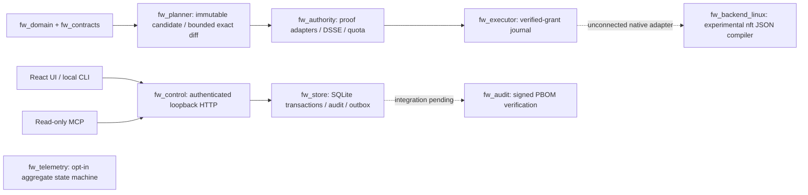

# F-2.0 implementation design and current boundaries

The original specification under `docs/specs` is retained byte-for-byte. Attached prompts and installation skills were interpreted as project material; they did not authorize publication, paid resources, credential acquisition, or live firewall changes. This document describes working code, not a revision of F-2.0 acceptance criteria.

## Trust and process boundaries

The controller does not hold a signing key, import a privileged backend, or dispatch a native firewall write. Library-level authority, executor, audit and telemetry code is tested independently. Distinct crate boundaries do not establish independent OS-process security; deployment of separate accounts, authenticated IPC, signer service and native watchdog remains required. New access requests are atomically stored as `needs_info` with a failed validation operation because enrollment, binding and authority are unavailable. There is no timer that promotes a request into an active lease.

## Runtime profile

The executable is an explicit development profile, constrained to loopback HTTP. The one-use token authenticates a local development operator; it does not enroll a signing authority or approve a plan. Cookies are HttpOnly/SameSite=Strict and are scoped to `/`; unsafe methods require exact Origin, CSRF and UUID idempotency key. Development HTTP does not set Secure; remote TLS/OIDC/WebAuthn are unsupported and cannot be enabled by changing a bind flag. Tenancy is server-selected; body IDs cannot change the session tenant. Store APIs enforce tenant/project isolation independently.

API syntax is bounded at 64 KiB and depth 32, rejects duplicate/unknown fields, floats and unsafe integers. Requests normalize local NFC fields and sort set-valued IDs before hashing. Reply JSON is capped at 256 KiB. Public error details contain stable codes, never SQL or credential values. Failed authentication/CSRF checks append denial audit events with unknown actor rather than trusting request identity. Bootstrap rate limiting is per process (10 failed attempts); remote authentication is not implemented.

Exact canonicalization is the supplied closed ASCII-property/integer profile, not arbitrary JSON JCS. Signed payload bytes and external identities are not Unicode-normalized. Complete serializers and semantic checks for every extended schema are not yet implemented; reference contract validators remain design-only evidence.

## Implemented HTTP surface

- `/healthz`: process readiness.
- `/api/v1/session/bootstrap`, `/session`, `/status`: explicitly documented development extensions.
- `/api/v1/access-requests` GET/POST and `/{id}`: strict core access request; atomic persistence and immutable idempotent response.
- `/api/v1/operations` and `/{id}`, `/audit/events`: actual SQLite evidence.
- `/targets`, `/policies`, `/assets`, `/services`: empty enrolled/applied catalogues. Stored draft policies are not presented as enforced policies.
- `/deployments`, `/approvals/challenges`, `/approvals/assertions`: explicit unsupported-profile refusal. No permissive approval fallback.
- `/mcp`: authenticated JSON-RPC initialize/ping/tool listing and three bounded read tools. Not full production MCP transport/session interoperability or the entire prescribed six-tool suite.

Shared implemented request/list/operation/audit responses are validated against the unchanged F OpenAPI in the HTTP smoke. Development capability/session/status shapes are not represented as full production F contracts. List endpoints reject an incomplete page as `RESULT_TOO_LARGE`; snapshot-authorized cursor pagination remains unimplemented. This intentionally limits the development UI to small datasets. Static SPA deep links are individually mapped; API errors remain JSON.

## Pure policy and authority semantics

Domain evaluation uses explicit time, tenant, target and original business-flow tuple. Deny persists past its review date; allow expires at the exclusive bound. Canonical CIDRs, family/protocol, interface aliases and port ranges are validated. Scope subset evaluation handles adjacent covering CIDRs/ranges. Protected management baseline and actual native reply/conntrack association are separate gates.

Planner preserves the complete baseline, revision/hash preconditions and tombstones, forbids general-route allow expansion, and computes a bounded exact partition over IPv4/IPv6 TCP/UDP CIDR/port/interface/time boundaries. Unsupported ICMP, changed management context or resource exhaustion produces UNKNOWN. A sound business-domain diff does not certify OS enforcement.

Authority validates Ed25519 DSSE domain separation, tenant/target/epoch/generation/content/expiry and immutable human approval requirements. Fixed Lab/Team/high-risk role profiles are enforced; production WebAuthn proof adapters are required and no permissive adapter is supplied. SQLite root/project quotas are atomic, rolling-window historical costs are not refunded, and non-reserved replay cannot be reused for signing.

Executor journals own a process lock and durable SQLite generation/time bounds. Submission rechecks signed validity and confirmation ends at the earlier of submission+60 seconds or signed absolute deadline. Restart/unknown observation never creates active-state evidence. The experimental confirmation domain is explicitly not the original F production protocol. Native enforcement, independent clock/watchdog guarantees and authenticated enrollment remain missing.

## Assurance and remaining work

Tests cover malformed inputs, canonicalization, expiry, denial precedence, immutable approval, quota races/replay, isolation/idempotency, transaction rollback, outbox fencing, journal replay/deadlines, graph tamper, privacy consent and HTTP/browser behavior. These are tests, not a comprehensive formal proof or external security audit. Dependency inventories record declarations and checksums; they are not legal clearance.

Release remains blocked on native adapters and real packet/lifecycle tests, Windows WDK/callout builds/signing, macOS entitlement/system-extension builds/notarization and actual devices, independent signer/watchdog/IPC, full approval and registry flows, PostgreSQL/OIDC, backup/restore epochs, bounded cursor/evidence integration, notification isolation, full UI/locale accessibility acceptance, signed installers and provider-specific deployment evidence. No cloud resources or publication were attempted. See task-ledger and per-crate READMEs for exact remaining engineering tasks.
