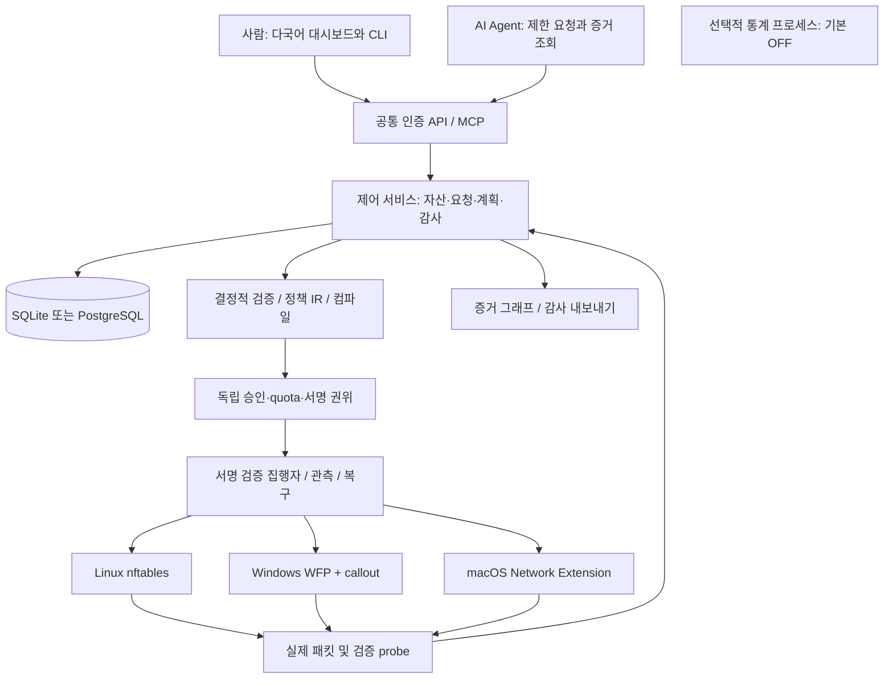

# 제품 및 구현 기준

**기준판 F-2.0 · 2026-10-30 · 개발 착수용 규범 명세**

## 1. 최종 제품 정의와 판본 우선순위

Windows, macOS, Linux 생태계에 각각 직접 설치할 수 있는 오픈소스 호스트 방화벽이다. Windows Server와 macOS를 서버로 운영하는 환경, Linux 서버를 모두 포함한다. 설치한 OS의 실제 통신을 제어하며, 다른 OS에 있는 방화벽 화면만 보여주는 제품으로 요구사항을 축소하지 않는다. AI 없이도 요청·승인·집행·감사 기능이 작동한다. AI는 설명과 초안 작성, 제한된 접근 요청 및 증거 조회를 수행한다.

공개 정책은 **Apache-2.0 + 기본 OFF인 선택적 사용 통계 + 자발적 후원**이다. 프로젝트 이름은 Warden 계열을 검토 중이다. 최종 브랜드가 정해지기 전 기술 모듈명은 `fw_*`로 유지하고 이름 결정 때문에 권한 계약을 바꾸지 않는다. Frankenward는 사용자 선호에서 제외한다.

F-2.0은 동봉한 F-1.0 통합 설계의 구현 세부를 보완하며, 다음 항목을 명시적으로 대체한다.

| F-1.0 항목 | F-2.0 최종 기준 |
|---|---|
| Linux만 집행 검수; Windows/macOS는 UI·개발 호스트 | 세 OS의 네이티브 설치와 호스트 집행이 필수. Linux routed gateway는 별도 프로필 |
| nftables 전용 집행 | 공통 의미 계약 + nftables / WFP / Network Extension backend |
| 소규모 핵심 JSON 계약만 제공 | 확장 도메인, HTTP, DB, UI, 감사, 다국어, 운영, 작업 순서까지 동봉 |
| 기존 Linux 아키텍처 그림 | 역사적 기준 자료. 현재 아키텍처는 아래 구성 및 F_09 문서 |
| 라이선스 후보·통계 미결 | Apache-2.0 공개, 명시적 opt-in 통계, 자발적 후원으로 결정 |

그 밖의 deny 우선, 현재 허용 집합, 제한 위임, 독립 서명, UNKNOWN 보수 처리, 만료·복구 의미는 유지한다. 우선순위는 최신 명시적 사용자 결정 → 이 문서의 변경표 → 분야별 F-2.0 명세/계약 → F-1.0 원칙이다. 같은 판본의 prose·schema·API 간 모순은 자동 선택하지 말고 한 변경에서 고친다. 제품 구현 및 실기기 인증은 아직 완료되지 않았다.

## 2. 지원 프로필

| 프로필 | 필수 범위 | 완료 판정 |
|---|---|---|
| `common-host-v1` | 세 OS, IPv4/IPv6 TCP/UDP, 명시적 ICMP, inbound/outbound, deny, 임시 allow, 회수·만료·관측·감사 | 각 OS의 명시된 버전·CPU 조합별 실제 패킷 시험 |
| `linux-routed-v1` | Linux 2-interface 라우팅/FORWARD, 대칭 경로 | 별도 namespace/VM 시험. macOS·Windows 라우터 지원으로 외삽 금지 |
| `lite-v1` | 한 조직, SQLite, 로컬 설치, 동일한 보안 의미 | 로컬 프로세스 권한 분리·백업·복구 시험 |
| `team-v1` | PostgreSQL, OIDC, 독립 승인/서명 서비스, 여러 target | 조직 격리·경쟁·키 교체·접속 단절 시험 |

wire의 `deployment_profile=host`는 `common-host-v1` 검수 기준에, `routed_gateway`는 `linux-routed-v1`에 연결한다. `lab`은 격리 검수 배치다. 이 버전 이름 때문에 기존 core schema enum을 변경하지 않는다. `lite-v1`/`team-v1`은 저장소·권위 운영 모드다.

Linux 선행 개발은 가능하지만 Linux 완료만으로 전체 제품 완료로 표시하지 않는다. `designed → implemented → lab-verified → supported`는 증거에 따른 단계다. unsupported와 unverified를 supported로 바꾸는 UI 스위치는 없다. 구형 OS, 모바일 Android/iOS, BSD, 모든 Linux 배포판 전체를 무제한 지원한다는 뜻이 아니다. 정확한 초기 조합과 확대 절차는 F_09에 고정한다.

NAT, TLS 복호화, L7 WAF, VPN, inline IPS, XDP 가속, gateway HA, 벤더 장비 쓰기, FQDN 자동 확장은 후속 프로필이다. 이 기능 없이도 3OS 호스트 방화벽 제품을 완성한다. `service-lease` 장기 업무 허용은 별도 갱신 설계 전까지 미지원이며 core 임시 allow 최대 24시간을 우회하지 않는다.

## 3. 구성과 신뢰 경계

통계 프로세스는 정책·패킷·서명 키 저장소에 접근하지 않는다. AI worker는 signer/executor 자격증명을 보유하지 않는다. UI는 권한 판정자가 아니다. 관리 트래픽과 데이터 트래픽은 분리하며 설치 시 관리 채널을 검증하기 전 전체 차단 모드를 활성화하지 않는다.

Lite에서도 controller와 privileged executor는 별도 프로세스/OS 계정으로 분리한다. signer 키는 controller가 읽지 못하도록 ACL과 IPC peer identity를 강제한다. 같은 호스트의 관리자/root 침해에 대한 독립 보안 경계를 보장하지 않는다. Team은 별도 호스트의 권위 서비스를 권장하며 이 경우에도 신뢰 루트 침해는 보장 밖이다.

## 4. 저장소와 모듈 책임

| 경로 | 책임 | 의존 금지 |
|---|---|---|
| `crates/fw_domain` | 순수 타입·정규화·scope·수명·참조 판정기 | DB, 네트워크, OS 쓰기 |
| `crates/fw_contracts` | strict serde, schema 호환, canonical hash | 클라이언트 제출 권한 신뢰 |
| `crates/fw_planner` | baseline+patch 합성, semantic diff, gate·probe 계획 | 커널 쓰기·키 접근 |
| `crates/fw_authority` | 승인, root/project quota, 신뢰 registry, 서명 | AI 결과 자동 승인 |
| `crates/fw_store` | migration, transaction, outbox, queue, audit | DB 결과를 실제 장치 상태로 추정 |
| `crates/fw_control` | REST, 정적 UI, read model, 조직 격리 | 관리자 shell 실행 |
| `crates/fw_executor` | grant 검증, durable generation, apply/readback/confirm/recover | 임의 command 문자열·unsigned artifact |
| `crates/fw_backend_linux` | nft artifact와 관측 | 타 manager의 전체 ruleset flush |
| `crates/fw_backend_windows` | WFP service와 driver IPC | Defender 일괄 비활성화 |
| `native/windows-callout` | 작은 WDK callout, packet-time 판정 | HTTP·DB·LLM·동적 할당을 hot path에 사용 |
| `native/macos` | 서명된 host app, system extension, XPC | PF production fallback |
| `crates/fw_mcp` | MCP wire, 도구별 권한, 응답 envelope | agent에 승인·trust 변경 도구 노출 |
| `crates/fw_cli` | API client, status, export, local recovery 진입 | 사용자 인증 없는 루트 원격 API |
| `crates/fw_telemetry` | 동의 범위 집계와 전송 | raw flow, CIDR, user prompt 읽기 |
| `web` | React/TypeScript 정적 UI, 다국어·접근성 | 서비스 키·방화벽 직접 호출 |
| `tests` | 계약·의미·API·DB·OS·설치·복구 시험 | 운영망 대상으로 기본 실행 |
| `docs/specs`, `docs/specs/F_기준자료` | F-2.0 기준과 F-1.0 근거 | 기존 기준 자료를 현재 실측으로 인용 |
| `scripts`, `packaging`, `.github` | 재현 빌드·설치·CI·공개 운영 | 개발 인증서를 출시 인증서로 취급 |

기술 선택은 Rust stable와 Cargo workspace, TypeScript strict와 React, SQLite Lite/ PostgreSQL Team으로 확정한다. Rust의 실제 compiler patch, crate semver, Node LTS patch, npm dependency patch, WDK/Xcode SDK는 M00에서 상호 호환·취약점·라이선스를 확인하고 lockfile 및 toolchain 파일에 정확히 고정한다. 이는 API/제품 의미의 미결정이 아니라 구현 착수 시점의 공급망 고정 작업이다. 실행 시 Node/Python은 제품 필수가 아니다. Python은 동봉 명세 검증 도구용이다.

## 5. 공통 기능 요구사항

| ID | 구현 요구 | 명세/인수 증거 |
|---|---|---|
| R15 | 세 OS 직접 설치·제거·업데이트 | F_09 native installer + rollback 시험 |
| R16 | 공통 host 방화벽 의미 | F_04/F_07/F_09 동일 fixture 결과 |
| R17 | 영어·한국어·일본어·스페인어·중국어 간체/번체 | F_05 문구 parity, 언어별 주요 흐름 QA |
| R18 | 전체 변경 생애 timeline | F_05/F_10 request ID부터 signed receipt까지 연결 |
| R19 | 의도한 경로와 관측한 사실을 구분 | F_10 topology proof 상태와 시각 |
| R20 | 사람·Agent 동일 근거 조회 | read-only API, RBAC, pagination, schema version |
| R21 | 검증 가능한 감사 내보내기 | 서명 manifest·해시·redaction·누락 범위 |
| R22 | 선택 통계 기본 차단 | F_06 동의 전/철회 후 0 network event |
| R23 | Apache·기여·후원 운영 | F_06 및 동봉 공개준비 파일 |
| R24 | Codex 재현 개발 | F_08 작업 ID, 테스트 명령, evidence report |

기존 R01–R14도 계속 필수다. 구현 완료를 주장하는 PR은 요구 ID와 인수시험 ID를 함께 남긴다.

## 6. 보안과 비기능 요구

네트워크 입력은 strict JSON: 중복 키, unknown property, nonfinite/floating number, 잘못된 UTF-8, 너무 깊은 중첩을 거절한다. 공용 API body 64 KiB, MCP response 256 KiB, list page 기본 50/최대 100, 단일 scope CIDR 256개, 포트 range 256개, asset/service expansion 4096 branch를 초기 상한으로 한다. 상한 초과를 일부 잘라 적용하지 않는다. 응답 목표 2초를 넘는 작업은 202와 상태 조회로 전환한다. 비동기 검증 단계 상한은 5초, 계획 생성 작업 상한은 30초이며 초과하면 timeout으로 종료한다. 더 작은 조직 제한이 우선한다.

API의 subject/role/org는 검증된 자격증명에서 추출한다. F_02 인증 계약을 정본으로 삼는다. 로컬 최초 등록은 콘솔에서 만든 10분 단일사용 bootstrap token과 loopback bind로 제한한다. 등록 후 token을 폐기한다. 원격 UI는 TLS, allowlisted Origin, CSRF 보호, Secure/HttpOnly/SameSite cookie를 사용한다. secret은 브라우저 localStorage나 로그에 저장하지 않는다. 로그·자산 설명·AI 응답의 HTML은 실행하지 않는다.

system/runtime/data/config 경로는 플랫폼 기본 디렉터리를 따른다. Linux `/etc/fw`, `/var/lib/fw`, `/run/fw`; Windows `%ProgramData%\Warden`와 ACL된 named pipe; macOS `/Library/Application Support/Warden`와 XPC. 브랜드 확정 시 표시 경로만 1회 변경하고 migration을 기록한다. 파일 기반 Lite DB는 네트워크 공유 폴더/NFS/SMB에 두지 않는다. 권위 DB와 executor generation journal은 fsync/write-through 및 crash test를 요구한다.

알림·웹훅은 관리자가 등록한 HTTPS 목적지만 사용한다. SSRF 방지를 위해 DNS/IP 재검증, redirect 금지, 사설/loopback/metadata 목적지 기본 금지, timeout 5초, payload 64 KiB, secret header redaction, 지수 backoff 최대 5회를 적용한다. 알림 실패가 정책 재적용을 유발하지 않는다. 외부 provider API 연결은 기본 비활성이다.

성능은 실측 전 목표다: 단일 target 1000 policy/5000 branch fixture에서 계획 p95 2초, UI list p95 500ms, 256 node/512 edge 그래프 조작 30fps, 일반 read API 100req/s 기준 p95 300ms. 정확한 CPU/RAM/OS/packet size/offload/concurrency와 percentile 표본 수를 보고한다. forwarding throughput을 localhost UI 부하로 입증하지 않는다. 과부하 시 새 확대 요청을 거절하고 기존 데이터 평면과 만료를 유지한다.

## 7. 설치와 운영 생애

설치 순서: package signature 검증 → 전제 조건/타 방화벽 충돌 탐지 → 상태 디렉터리·계정 생성 → DB migration → loopback bootstrap → target enrollment/capability probe → 관리 복구 경로 확인 → observe-only → 승인된 initial baseline 적용 → readback/positive·negative/new management probe → enforced 상태다. observe-only는 보호 중으로 표시하지 않는다. installer가 기존 OS 방화벽을 임의로 끄지 않는다.

업데이트는 서명·해시·지원 버전 확인, DB 백업, 호환성 검증, control부터 교체, executor drain, native backend 교체, readback 후 완료한다. driver/extension 업데이트 중 안전한 차단 상태를 입증하지 못하면 maintenance window를 요구한다. 이전 프로그램으로 되돌리기 위해 DB를 억지 다운그레이드하지 않는다. 미지 버전의 grant/schema는 거절한다.

제거는 관리자가 현재 보호 해제의 영향을 확인한 후 수행하는 명시적 동작이다. 자기 소유 rule/filter/extension만 제거하고 타 제품 규칙을 건드리지 않는다. retain-data가 기본이며 purge는 별도 선택이다. 원격 제거 전에 out-of-band 경로를 확보한다. 설치·업데이트·제거 실패의 재실행은 idempotent여야 한다.

백업은 DB 일관 snapshot, audit manifest, encrypted trust metadata, executor epoch 참조를 포함하되 private key는 별도 보관한다. 복원은 신뢰 root가 승인한 새 authority epoch 전이 후 target을 재조정하고 과거 grant/만료 allow를 재활성화하지 않는다. RPO 24시간/RTO 1시간은 작은 Lab의 초기 운영 목표이며 Team은 조직이 검수한 값으로 설정한다. 백업 성공 메시지만으로 복원 가능을 주장하지 않는다.

## 8. 개발과 출시의 완료 경계

이번 산출물은 구현에 필요한 기준 문서·계약·검증기·작업 계획이다. 아직 방화벽 바이너리나 OS installer를 제공하는 것이 아니다. 문서/JSON 검증 통과는 WFP/Network Extension/nftables 집행 성공을 뜻하지 않는다. 필요한 driver 서명, Apple entitlement/배포 서명, 실제 테스트 장치는 OS별 release gate다. 검증 불가능한 보안 속성을 타이머 한 개로 대체하지 않는다. 그러한 항목은 정확히 미지원으로 노출하고 관련 확대 배포를 거절한다.
